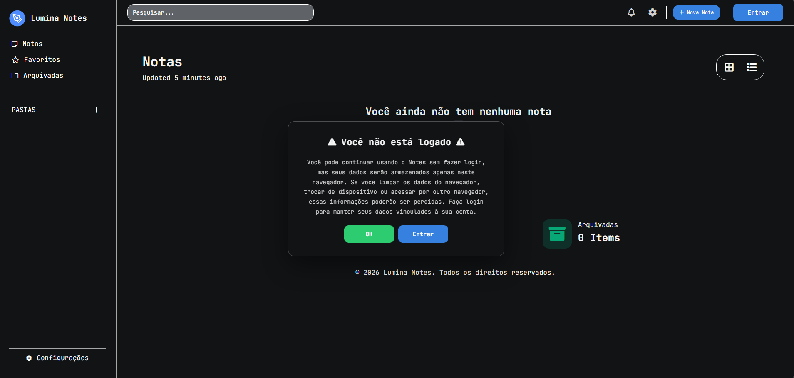
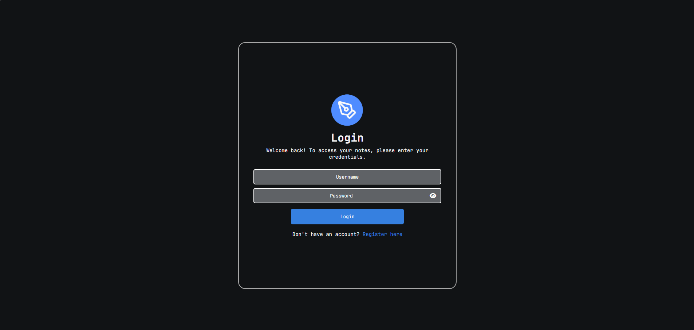
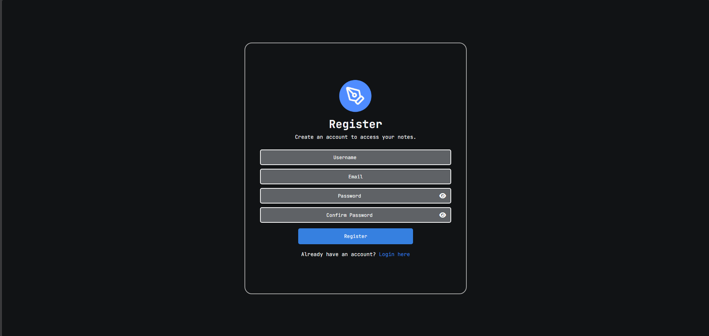
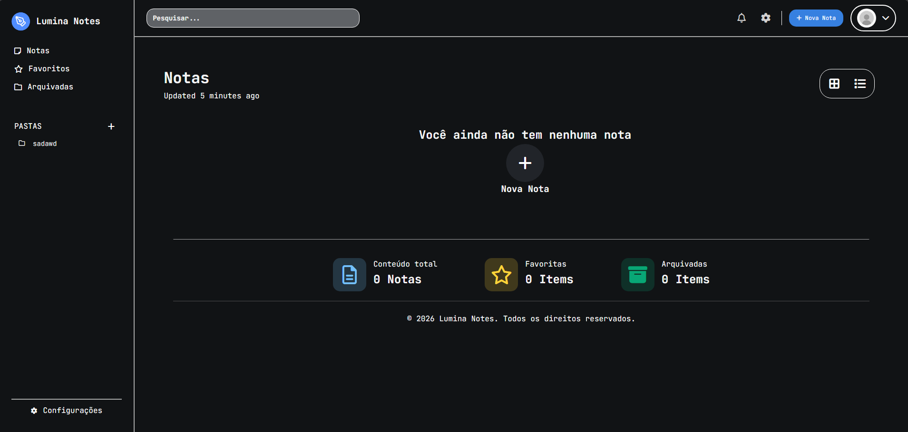
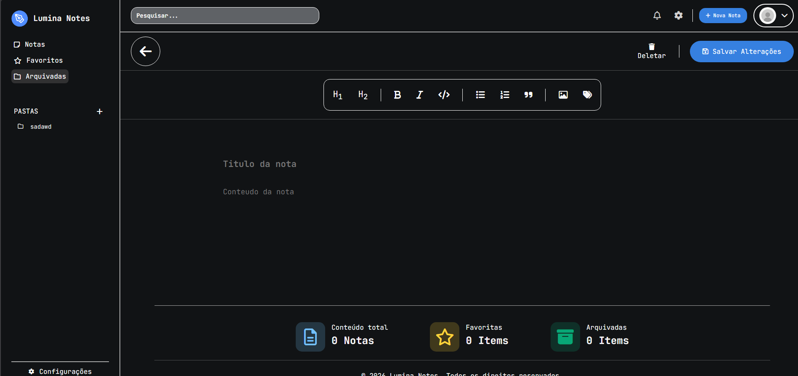
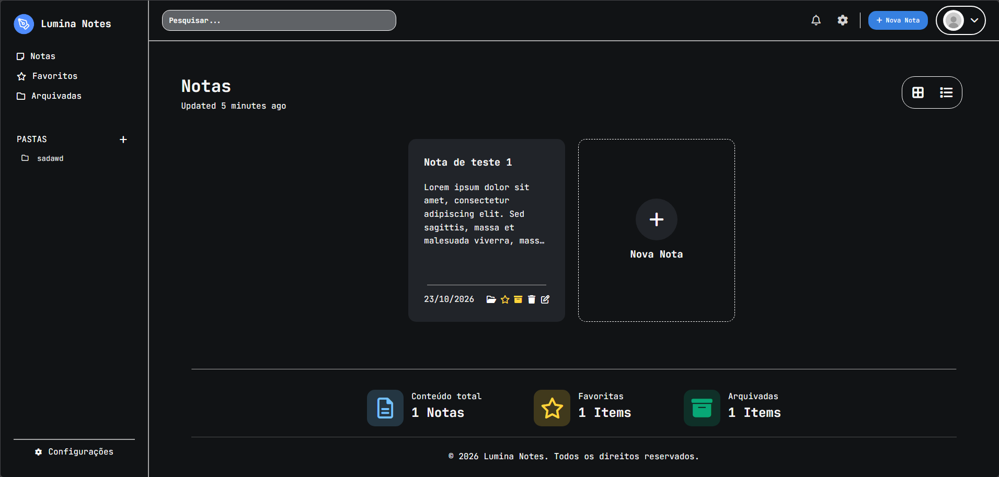
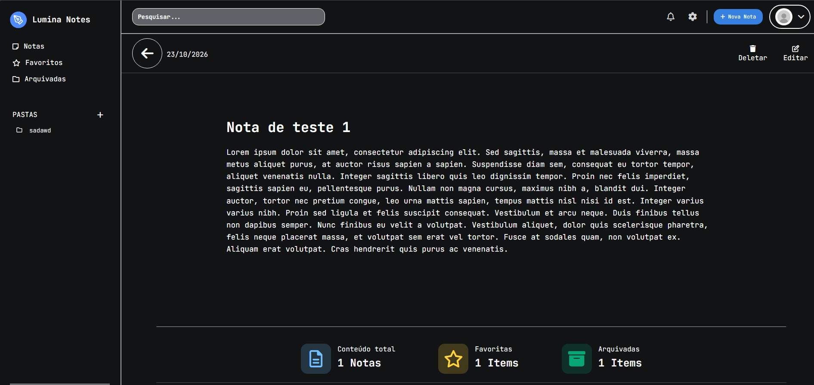

# Lumia Notes

**Lumia Notes** é uma aplicação web de anotações desenvolvida com Django, projetada para organizar ideias e informações em uma interface simples e intuitiva.

O projeto oferece gerenciamento de notas, organização por pastas e recursos para facilitar o acesso às informações do dia a dia.

## ✨ Funcionalidades

- **Gerenciamento de notas:** criar, visualizar, editar e excluir anotações.
- **Organização por pastas:** agrupar notas de acordo com suas categorias ou assuntos.
- **Favoritos:** marcar notas importantes para acessá-las rapidamente.
- **Arquivamento:** manter notas arquivadas separadas das anotações ativas.
- **Tags:** adicionar etiquetas para facilitar a organização.
- **Pesquisa:** localizar anotações pelo conteúdo disponível na aplicação.
- **Autenticação:** cadastro, login e gerenciamento de notas vinculadas ao usuário autenticado.
- **Acesso para visitantes:** permitir o uso da interface de anotações sem autenticação, utilizando armazenamento local no navegador.

## 📸 Capturas de tela









## 🛠️ Tecnologias

- **Python** — linguagem principal do backend.
- **Django** — framework web e gerenciamento de dados.
- **JavaScript** — interações e funcionalidades dinâmicas da interface.
- **HTML5** — estrutura das páginas.
- **CSS3** — estilização e responsividade.
- **SQLite** — banco de dados utilizado no ambiente local.

## 📂 Estrutura do projeto

```text
Lumia-Notes/
├── .gitignore
├── README.md
└── lumianotes/
    ├── manage.py
    ├── db.sqlite3
    ├── accounts/
    │   ├── migrations/
    │   ├── static/
    │   ├── templates/
    │   ├── models.py
    │   ├── urls.py
    │   └── views.py
    ├── notes/
    │   ├── migrations/
    │   ├── static/
    │   ├── templates/
    │   ├── models.py
    │   ├── urls.py
    │   └── views.py
    └── lumianotes/
        ├── settings.py
        ├── urls.py
        └── wsgi.py
```

## 🚀 Como executar o projeto

### Pré-requisitos

- Python instalado.
- Git instalado.

### 1. Clone o repositório

```bash
git clone https://github.com/mineclash14/Lumia-Notes.git
cd Lumia-Notes
```

### 2. Crie um ambiente virtual

```bash
python -m venv .venv
```

### 3. Ative o ambiente virtual

**Windows — PowerShell:**

```powershell
.\.venv\Scripts\Activate.ps1
```

**Windows — Prompt de Comando:**

```bat
.venv\Scripts\activate.bat
```

### 4. Instale as dependências

```bash
python -m pip install -r requirements.txt
```

### 5. Execute as migrações

Entre na pasta que contém o `manage.py`:

```bash
cd lumianotes
python manage.py migrate
```

### 6. Inicie o servidor

```bash
python manage.py runserver
```

Acesse a aplicação em:

http://127.0.0.1:8000/

## 📌 Objetivo do projeto

O Lumia Notes é um projeto de desenvolvimento web criado para praticar e demonstrar conhecimentos em Python, Django, JavaScript e desenvolvimento de interfaces.

Sua construção envolve conceitos como autenticação de usuários, operações CRUD, integração entre frontend e backend, persistência de dados e organização de aplicações Django.

## 👨‍💻 Autor

Desenvolvido por **Rafael**.

- GitHub: [@mineclash14](https://github.com/mineclash14)

---

Desenvolvido com Python, Django e JavaScript.
